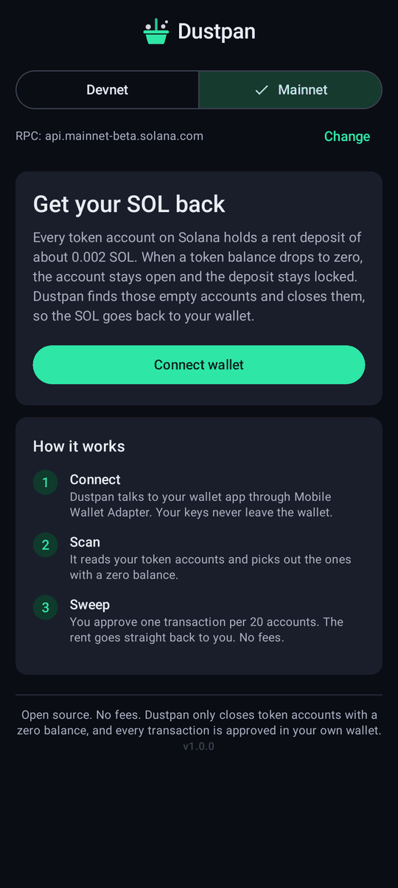
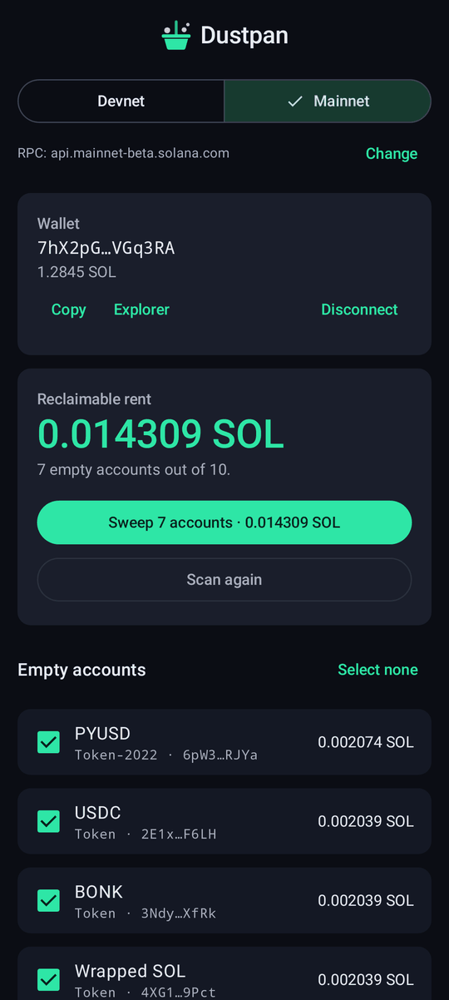
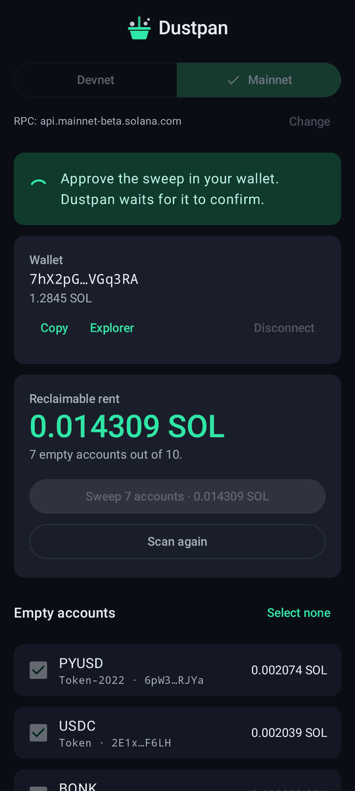
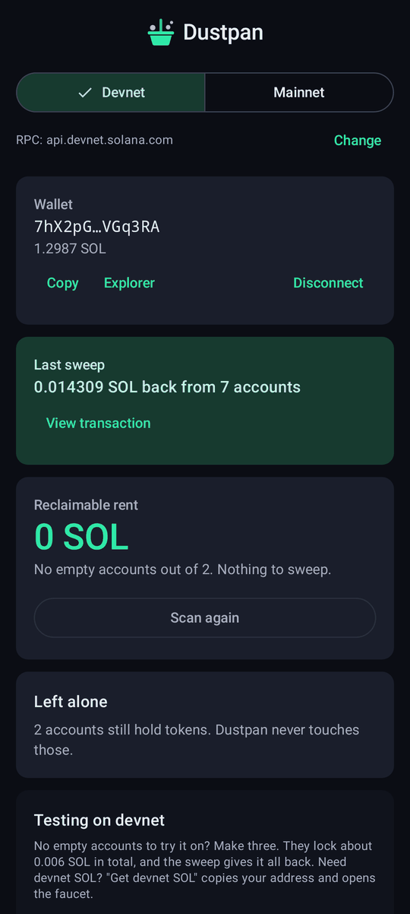

# Dustpan

**Sweep up empty Solana token accounts and get your SOL back.**
An Android app that connects to your wallet with Mobile Wallet Adapter. No fees, no backend, fully open source.

<p>
  
  
  
  
</p>

**APK:** [`release/dustpan-1.0.0.apk`](release/dustpan-1.0.0.apk) · Android 8.0+ · runs on ARM and x86 emulators

## The problem

Every SPL token account holds a rent deposit of 0.00203928 SOL. When you sell or send away all of a token, the account stays open and the deposit stays locked. Solana doesn't close these accounts for you. If you trade, claim airdrops or try a lot of tokens, you end up with dozens or hundreds of them.

The popular cleanup tools are websites, and most keep a cut of what you recover (anywhere from about 1% to 20%). There was no simple, open source, fee-free option built for phones that works with the wallet already on your device.

## What Dustpan does

1. **Connect.** Dustpan talks to your wallet app through Mobile Wallet Adapter. Your keys never leave the wallet.
2. **Scan.** It reads your SPL Token and Token-2022 accounts and lists the empty ones with the SOL each one holds.
3. **Sweep.** You pick what to close and approve in your wallet. Each `CloseAccount` sends the rent straight back to you. Up to 20 accounts per transaction.

What it won't touch, and why:

| Account | What Dustpan does |
| --- | --- |
| Still holds tokens | Left alone, always |
| Frozen by the token issuer | Listed under "Left alone" |
| Close authority belongs to another address | Listed under "Left alone" |
| Token-2022 with withheld transfer fees or confidential transfers | Listed under "Left alone" |

## Try it

You need an Android device or emulator with a wallet that supports Mobile Wallet Adapter, for example Phantom, Solflare, or the `fakewallet` test app from the [solana-mobile/mobile-wallet-adapter](https://github.com/solana-mobile/mobile-wallet-adapter) repo.

1. Install the APK: `adb install release/dustpan-1.0.0.apk`, or drag the file onto the emulator window.
2. Open Dustpan. It starts on **Devnet**. Tap **Connect wallet** and approve in your wallet. (In Phantom, turn on Testnet Mode in developer settings first.)
3. Need devnet SOL? **Get devnet SOL** copies your address and opens [faucet.solana.com](https://faucet.solana.com). The devnet RPC airdrop has been shut off, so the web faucet is the way.
4. Tap **Make 3 test accounts** and approve. This creates three empty token accounts (devnet USDC, wrapped SOL, devnet USDC) that lock about 0.006 SOL.
5. Tap **Sweep 3 accounts** and approve. The SOL comes back, the receipt links to Solana Explorer, and the list is empty again.

On **Mainnet** the same flow works on your real accounts. The public RPC is rate limited, so heavy wallets should tap **Change** and paste their own RPC URL.

## How it works

- **Scan:** `getTokenAccountsByOwner` with `jsonParsed` encoding, once for each token program.
- **Sweep:** one `CloseAccount` instruction per account, with your wallet as the destination. Twenty closes come to about 980 bytes, which leaves room under Solana's 1232-byte limit for wallets that add priority-fee instructions. Transactions go out through MWA `signAndSendTransactions`. If the wallet reports a per-request limit, Dustpan splits them across prompts. Wallets that can't submit sign only, and Dustpan submits over RPC.
- **Safety check:** before anything is signed, Dustpan confirms the wallet's authorized account is the one it scanned.
- **Test accounts:** `createAccountWithSeed` plus `InitializeAccount3`, so only your wallet signs and there are no throwaway keypairs.

```
app/src/main/java/app/dustpan/
├── MainActivity.kt        sets up the MWA ActivityResultSender
├── DustpanViewModel.kt    MWA connect and transact, scan, sweep, devnet helpers
├── ui/                    Jetpack Compose screen and theme
└── solana/                small Solana core with no extra dependencies:
                           Base58, keys, transaction encoding, JSON-RPC, token-account parsing
```

Built with Kotlin, Jetpack Compose (Material 3) and `com.solanamobile:mobile-wallet-adapter-clientlib-ktx` 2.1.1.

## Build

You need JDK 17 or newer and the Android SDK (platform 36).

```bash
./gradlew assembleDebug      # app/build/outputs/apk/debug/app-debug.apk
./gradlew assembleRelease    # app/build/outputs/apk/release/app-release.apk
```

Release builds are signed with your key if a `keystore.properties` file exists in the project root. It's git-ignored. Without it, they fall back to the debug key so they still install.

```properties
storeFile=/path/to/your-release.jks
storePassword=...
keyAlias=dustpan
keyPassword=...
```

The connect screen in the wallet shows the app's identity URI. Set `dustpan.identityUri` in `gradle.properties` to your own repo or site.

## Tests

```bash
./gradlew testDebugUnitTest
```

- **Encoder parity:** our transactions are checked byte for byte against `@solana/web3.js` and `@solana/spl-token`. The fixture generator is in `tools/fixtures`.
- **Scanner edge cases:** frozen accounts, foreign close authorities, withheld fees, confidential transfers and responses without parsed data.
- **End to end (optional):** runs the app's own code against a real validator. It creates 24 token accounts, finds the 23 empty ones, sweeps them in two transactions and checks the balance to the lamport.

  ```bash
  solana-test-validator --reset &
  DUSTPAN_E2E_RPC=http://127.0.0.1:8899 ./gradlew testDebugUnitTest
  ```

CI (GitHub Actions) runs the tests and builds an APK on every push and pull request. CI builds are signed with a throwaway debug key, so use the APK in `release/` for anything you hand out.

## Ideas for next steps

- Burn-and-close for spam tokens, with a clear warning
- Token names and icons from on-chain metadata
- A reminder when new empty accounts show up
- A Solana dApp Store listing

## License

MIT. See [LICENSE](LICENSE).
